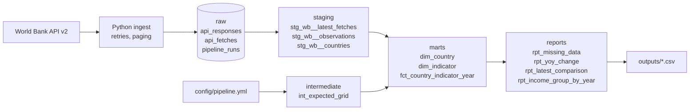
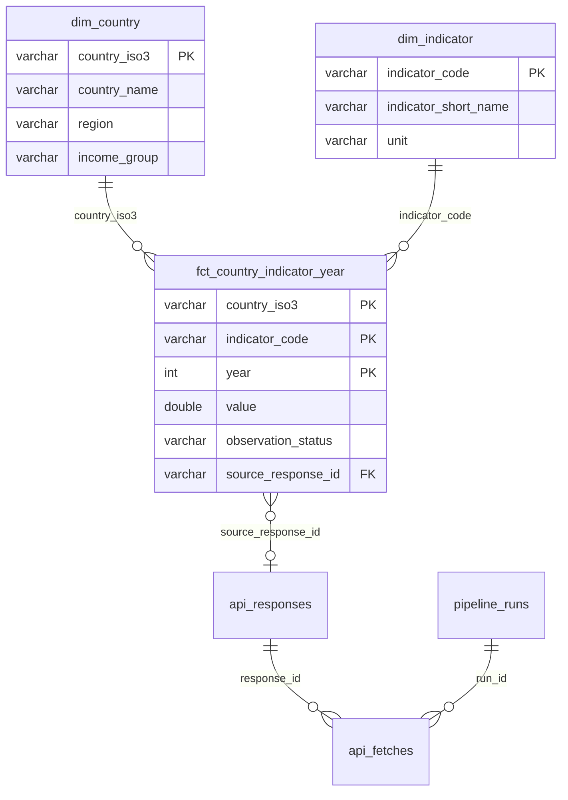

# World Bank indicators pipeline

A local, configuration-driven pipeline that pulls yearly country indicators from the public
[World Bank API v2](https://datahelpdesk.worldbank.org/knowledgebase/articles/889392), lands the
raw responses untouched, and builds a tested dimensional model plus four reporting views with dbt
on DuckDB. Dagster orchestrates it as assets with full lineage, and a single command runs it all.

**Scope (from `config/pipeline.yml`):** BRA, CAN, DEU, GBR, IND, JPN, MEX, USA, ZAF ×
population, GDP (current US$), GDP per capita (current US$), life expectancy × 2018–2024.

## How this answers the assessment

| Requirement | Where |
|---|---|
| Country metadata + indicator observations from the API | `src/wb_pipeline/ingest.py`, `api.py` |
| Paging and API failures | `api.py` (retries, backoff, HTML/502 detection, paging completeness), second pass in `ingest.py` |
| Every value traceable to its API response | `fct_country_indicator_year.source_response_id` → `raw.api_responses` ([Traceability](#data-model)) |
| Single documented command from a clean checkout | `uv run wb run` ([Quick start](#quick-start)) |
| Re-run with unchanged source creates no duplicates | content-addressed raw + latest-successful-run staging; `tests/test_reprocessing.py` |
| No cloud resources / accounts | local DuckDB; public API only |
| Raw separate from cleaned and analytics-ready | `raw` → `staging` → `marts` → `reports` schemas |
| Grain, business keys, relationships documented | [Data model](#data-model), `dbt/models/**/schema.yml` |
| Standardized for analysts | typed, renamed columns; explicit `observation_status`; short indicator names |
| Add a country / indicator by configuration | `config/pipeline.yml` ([how](#adding-a-country-or-an-indicator)) |
| Missing / incomplete combinations | `reports.rpt_missing_data` |
| YoY change with missing or zero priors | `reports.rpt_yoy_change` (`change_status`) |
| Latest-available-year comparison | `reports.rpt_latest_comparison` |
| Indicators by income group, by year | `reports.rpt_income_group_by_year` |
| Automated DQ checks, cross-indicator consistency | `dbt/tests/`, schema tests ([Data quality](#data-quality-and-tests)) |
| Tests without the live API | `uv run pytest` (recorded real responses in `tests/fixtures/`) |
| Production design note | [Production design note](#production-design-note) |
| Sample output | `outputs/*.csv` |
| Optional extra | Dagster asset graph with lineage, asset checks and a daily schedule |

## Quick start

Requires [uv](https://docs.astral.sh/uv/) (it installs Python 3.12 and every dependency).

```bash
uv run wb run          # ingest -> dbt build (models + data tests) -> outputs/*.csv
uv run pytest          # offline test suite (no network; recorded API responses)
uv run dagster dev     # optional: Dagster UI at http://localhost:3000 (asset graph, daily schedule)
```

`wb run` is the single command; from a clean checkout it creates `data/warehouse.duckdb` and
rewrites `outputs/`. Sub-steps can be run on their own: `uv run wb ingest | transform | export`.
Exit code is non-zero if the API cannot be read or any data test fails.

Inspect the warehouse with any DuckDB client, for example:

```bash
uv run python -c "import duckdb; print(duckdb.connect('data/warehouse.duckdb').sql('''
  select indicator_short_name, country_iso3, latest_year, value, rank_desc
  from reports.rpt_latest_comparison order by indicator_short_name, rank_desc'''))"
```

### Dagster (optional)

`uv run dagster dev` serves the same pipeline as a Dagster asset graph at http://localhost:3000.
Every dbt model is an asset, every dbt test an asset check, and `wb_daily_job` has a daily
schedule (off by default, as Dagster ships it). Use **Materialize all** on the Lineage page to run
it. Set `DAGSTER_HOME` to a directory to keep run history between sessions.

### Repository layout

```
config/pipeline.yml        countries, indicators (+ plausibility bounds), years, API settings
src/wb_pipeline/           api.py (HTTP), ingest.py, raw_store.py, transform.py (dbt), export.py,
                           cli.py (`wb`), orchestration.py (Dagster)
dbt/                       dbt project: models/{staging,intermediate,marts,reports}, tests/, macros/
tests/                     pytest suite + fixtures/ (real API responses, recorded)
tools/record_fixtures.py   re-record fixtures from the live API (resumable)
outputs/                   sample report CSVs from a live run
```

## Architecture



| Layer | What it holds | Written by |
|---|---|---|
| `raw` | Exact API response bodies (content-addressed), a manifest of every fetch, a run log | `src/wb_pipeline/ingest.py`, `raw_store.py` |
| `staging` | JSON flattened to typed, analyst-named columns; only the latest *successful* run | `dbt/models/staging` |
| `intermediate` | The expected grid: configured countries × indicators × years | `dbt/models/intermediate` |
| `marts` | Dimensional model (below) | `dbt/models/marts` |
| `reports` | The four analytical answers | `dbt/models/reports` |

### Ingestion

- One request per country (metadata) and per country × indicator (full series, every page);
  years are filtered in the model, not in the request (see *API behaviour* below).
- Retries with exponential backoff on timeouts, connection errors, 429/5xx, and **HTTP 200 with a
  non-JSON body** (the WAF's HTML error page). API error payloads (`[{"message": ...}]`) fail fast.
- **Raw is append-only and content-addressed.** `raw.api_responses.response_id` =
  sha256(request URL + body). An unchanged re-run stores no new bodies; only a fetch manifest row.
- **Runs are all-or-nothing.** `raw.api_fetches` records which body every request got in every run;
  `raw.pipeline_runs` records whether the run succeeded. Staging reads only the latest successful
  run per request. A failed run is never visible downstream, and a source that changes and changes
  back (X → Y → X) resolves to X, because "latest" is decided by run, not by body.
  It also guarantees that all indicators of a country-year come from the same snapshot, which
  the GDP-per-capita consistency check relies on.
- The origin fails in bursts, so requests that exhaust their retries get **one more pass after a
  cooldown** (`second_pass_cooldown_seconds`) before the run is declared failed. Any other error
  (DuckDB, Ctrl-C) also marks the run `failed`; no run is left `running`.
- Paging is checked for completeness: the rows across all pages must add up to the API's `total`.

### Data model

| Table | Grain | Business key | Notes |
|---|---|---|---|
| `marts.dim_country` | one row per configured country | `country_iso3` | name, ISO2, region, income group (API's current classification) |
| `marts.dim_indicator` | one row per configured indicator | `indicator_code` | name, `indicator_short_name`, unit, plausibility bounds (from config) |
| `marts.fct_country_indicator_year` | one row per country × indicator × year in range (**dense**) | (`country_iso3`, `indicator_code`, `year`) | `value`, `observation_status`, `source_response_id`, `source_last_updated`, `source_fetched_at` |

Relationships: `fct.country_iso3 → dim_country`, `fct.indicator_code → dim_indicator` (tested).



`observation_status` makes missing data explicit instead of zero or absent:

| status | meaning | `value` | `source_response_id` |
|---|---|---|---|
| `reported` | API returned a number | number | the body it came from |
| `null_in_source` | API returned the year with `value: null` | NULL | the body that said null |
| `not_returned` | API did not return that year at all | NULL | NULL |

**Traceability:** every fact row's `source_response_id` joins to `raw.api_responses` (exact body
and request URL) and `raw.api_fetches` (run, page, `fetched_at`, the API's `lastupdated`).
Country-level reports carry `source_response_id` (NULL only where the API returned no row);
aggregates trace through the fact.

### Reports (`reports.*` views, exported to `outputs/*.csv`)

| Question | View | How |
|---|---|---|
| Missing / incomplete combinations | `rpt_missing_data` | every non-`reported` row, with its series' completeness % |
| Year-over-year change | `rpt_yoy_change` | `abs_change`, `pct_change`; `change_status` ∈ `ok`, `first_year_in_range`, `current_missing`, `prior_missing`, `prior_zero` explains every NULL; no divide-by-zero |
| Latest-year comparison | `rpt_latest_comparison` | each country at its own latest reported year, `rank_desc`, and `years_behind` the newest year any country has |
| By income group and year | `rpt_income_group_by_year` | totals summed; GDP per capita = Σ GDP / Σ population; life expectancy population-weighted; `simple_mean` for reference; `countries_in_aggregate` counts countries whose inputs (incl. GDP / population for the ratio and weighting) were all reported, and `is_complete` compares it with the group size |

**Sample outputs** in `outputs/` come from a live run on 2026-11-19 (45 requests; `dbt build`
green: 11 models and every data test). On that date the API reported all 252 combinations (the
World Bank had already published 2024 for all nine countries), so `rpt_missing_data.csv` has only
its header.
The missing-data paths (`null_in_source`, `not_returned`, YoY with missing priors) are covered by
the offline tests. On live data, setting `years.end: 2025` and running `uv run wb transform`
(no new API calls, since raw already holds the full series) yields 9 `null_in_source` rows for 2025.

### Adding a country or an indicator

Edit `config/pipeline.yml` and run `uv run wb run`. Countries are ISO3 codes; an indicator needs
`code`, `name`, `short_name`, `unit` and optionally `min_value` / `max_value` (enforced by a data
test). The config is passed to dbt as `--vars`, so the expected grid, the dimensions and the
density test follow it; no SQL changes. A new indicator is aggregated by simple mean in the
income-group report unless you add a rule for it there (its semantics decide sum vs. weighted).

## Data quality and tests

**dbt data tests** run on every `wb run` (a failure stops the pipeline before export):

- uniqueness of the fact's business key and of every report's grain; not-null keys
- relationships fact → dimensions; accepted values for `observation_status` and `change_status`
- density: the fact has exactly |countries| × |indicators| × |years| rows
- `value` present iff `reported`; `source_response_id` present iff the API returned the row
- plausibility bounds per indicator from config (population ≥ 1, GDP ≥ 0, life expectancy 20–100)
- **cross-indicator consistency:** reported GDP per capita equals GDP / population within 0.1%
  (measured: identical to rounding on real data)
- every observation belongs to the country and indicator that was requested
- configured countries all have metadata (name, income group)

**pytest** (`uv run pytest`, 46 tests, fully offline; `tests/fixtures/` holds real recorded
responses; also run by GitHub Actions on every push):

- API client: paging and its completeness check against `total`, retries on 5xx / timeouts /
  dropped connections / HTML-with-200, give-up and exponential backoff, API error payloads,
  404 not retried, `[meta, null]` empty series
- ingestion: second pass recovers a transient failure; any unexpected error marks the run failed
- raw store: identical bodies stored once, manifest per run, run status
- **reprocessing, end to end through the CLI:** unchanged re-run leaves the fact identical and adds
  no bodies; a corrected value flows to the fact with a new `source_response_id`; a revert
  X → Y → X shows X; an aborted run leaves the fact unchanged; a year missing from the response
  becomes `not_returned`; a two-page series lands every year in the fact
- report logic: YoY with zero and missing priors, stale latest-year flag, ratio-of-sums, and an
  income-group aggregate that is flagged incomplete when a companion input (GDP) is missing
- Dagster: definitions load with lineage raw → staging → marts → reports → CSV, and a full
  offline materialization succeeds

`tools/record_fixtures.py` re-records the fixtures from the live API (resumable).

## Assumptions

- **Income group is today's classification**, applied to every year. The API exposes no history;
  a country that changed group would need the World Bank's historical classification file.
- **Year range is inclusive** and applied in the model; the full series is fetched and stored raw.
- **YoY for the first year in range is not computed** (`first_year_in_range`), even though the raw
  layer holds 2017; the report answers within the configured window.
- **Latest available year is per country** (a country's last reported year ≤ end year), with
  `years_behind` making uneven recency visible rather than silently comparing different years.
- Values are kept as the API's doubles; units are the indicator's (current US$, people, years).

## Trade-offs

- **DuckDB + dbt-duckdb** instead of a server database: zero setup, same SQL dialect family and
  dbt project as a Snowflake deployment.
- **Marts rebuilt in full** every run (tables are tiny). Correct by construction and idempotent;
  the production note covers incremental `MERGE`.
- **Run-level atomicity** means one persistently failing series fails the whole run. I chose a
  consistent snapshot over partial freshness; with this API's flakiness a re-run usually succeeds.
- **No Docker:** `uv` already gives a reproducible, locked, one-command environment.
- **No dbt packages** (dbt_utils etc.): fewer moving parts for a clean checkout; the handful of
  tests needed are written as singular tests.
- **Data tests gate the export, not the marts.** `dbt build` replaces a table before running its
  tests, so a failed test stops the pipeline (non-zero exit, no CSVs) but the rebuilt tables stay
  in DuckDB. Locally that is acceptable; in production I'd build into a staging schema and swap
  only after tests pass (write-audit-publish, see the production note).
- **Annual indicators only.** `year` is cast from the API's `date`; a quarterly/monthly
  indicator (`2023Q1`) would fail the build loudly rather than load wrong data.

## API behaviour observed (2026-11-19, from one network)

The API sits behind Cloudflare. Cached URLs answered in milliseconds; requests that reached the
origin intermittently hung or returned **502 with an HTML error page**, sometimes for minutes on
the same URL. Requests with `date=` or `mrv=` filters, and `;`-joined country lists, failed
consistently in my tests. Hence the plain request shapes, read timeouts, retries with backoff,
treating non-JSON bodies as failures, and a resumable fixture recorder. These are observations on
one day, not documented API behaviour.

## Key decisions (walkthrough)

1. **Store bodies, not rows, in raw.** The body is the evidence. Everything downstream is a
   rebuildable function of it, which makes replay and audit trivial.
2. **Separate the body store from the fetch manifest.** Content hashing alone gives idempotency but
   breaks on reverts, page-level changes and aborted runs; the manifest + run status fixes all three.
3. **Dense fact on a config-driven grid.** Missing data becomes a row with a reason, so every report
   can count it, and "missing" can't be confused with "zero" or "not asked for".
4. **Aggregations that respect meaning.** Averaging GDP per capita across countries is wrong for a
   group; the report recomputes it from totals and weights life expectancy by population.
5. **One command, plus an orchestrator.** `wb run` keeps the reviewer's path short; Dagster shows
   the same graph as assets with per-model lineage, tests and a schedule.

## AI usage

I used Claude Code (Claude) as a pair throughout, and verified its output against the real API and
the tests rather than taking it on trust. Concretely:

- **Design review before code.** An AI review of the first design caught that content-hash dedupe
  plus "latest fetch wins" would serve stale data on a revert (X → Y → X), on page-level changes,
  and after aborted runs. That led to the fetch manifest + successful-run rule, and to the revert
  and aborted-run tests.
- **Probing the API.** The WAF/cache behaviour above was found by scripted probes, and an early
  theory (a whitelist of URL shapes) was discarded when cache headers showed it was origin
  flakiness instead. Code comments were corrected to claim only what was observed.
- **Measuring before asserting.** The GDP-per-capita tolerance was set after measuring
  GDP / population against the reported value (identical to rounding), not guessed.
- **Independent review.** A fresh AI review of the finished branch found no critical issues and
  four important ones, all fixed with a failing test first: a dropped connection mid-body wasn't
  retried and could leave a run stuck as `running`; no second pass for a flaky origin; no
  end-to-end multi-page test; and an `is_complete` flag that ignored missing GDP / population
  inputs in the income-group report.
- **Implementation** was test-first, task by task, from a written plan; I reviewed every model and
  test and own the decisions in this README.

## Production design note

**Scheduling and incremental refreshes**
- Daily schedule (the API's `lastupdated` changes a few times a year; daily is cheap insurance).
  The Dagster job here maps 1:1 to an Airflow DAG (MWAA) or Dagster+: `ingest → dbt build → export`.
- Skip work when nothing changed: compare each series' `lastupdated` / body hash with the last
  successful run and only re-fetch or rebuild what moved; dbt `state:modified+` / source freshness.
- Marts become incremental: `MERGE` into the fact on the business key
  (`country_iso3, indicator_code, year`), updating only rows whose `source_response_id` changed.

**Late, corrected or changed source data**
- The World Bank revises history. Raw keeps every body ever seen; the fact always reflects the
  latest successful snapshot, and the old value stays queryable through `raw`.
- For analyst-facing history, add an SCD2 snapshot (`dbt snapshot`) on the fact keyed by the
  business key, so "what did we report on date D" is answerable.
- A revision report (value changed vs. previous run, by how much) feeds review, not just overwrite.

**Monitoring, alerting and data-quality failures**
- Run-level: failed runs, retries exhausted, duration, request count vs. expected (alert on Slack /
  PagerDuty via the orchestrator).
- Data-level: dbt tests as gates (`error` blocks publishing, `warn` for soft checks like
  completeness drops), source freshness on `lastupdated`, row-count and null-rate deltas vs. the
  previous run, and the cross-indicator consistency test.
- Publish atomically: build into a staging schema and swap (or Snowflake zero-copy clone) only when
  tests pass, so consumers never see a half-good state.

**Backfills and replay**
- Replay = rebuild from raw: every mart is a pure function of stored bodies and the manifest, so a
  model fix is `dbt build --full-refresh` with no API calls.
- Backfill a new country / indicator / year range by config change and one run; partitions per
  indicator (Dagster static partitions / Airflow mapped tasks) let a single series be re-fetched.
- Pin a past snapshot by selecting a specific `run_id` instead of "latest successful".

**Mapping to Snowflake + AWS (or Azure)**

| Local | Snowflake + AWS | Azure |
|---|---|---|
| Python ingest | AWS Glue Python shell / Lambda (EMR is overkill at this volume), writing JSON to S3 | Azure Functions / Data Factory copy activity → ADLS Gen2 |
| `raw.api_responses` + manifest | S3 landing (immutable, versioned) → Snowpipe / `COPY INTO` a `VARIANT` raw table; streams on raw for CDC | ADLS → Snowflake on Azure (or Synapse / Fabric) via external stage |
| dbt-duckdb | dbt Core/Cloud on Snowflake; incremental `MERGE` on business key; `dbt snapshot` for history | same dbt project |
| DuckDB file | Snowflake database, `RAW` / `STAGING` / `MARTS` / `REPORTS` schemas, small warehouse with auto-suspend | same |
| Dagster | MWAA (Airflow) or Dagster+ | Data Factory / Airflow in AKS |
| CSV outputs | Secure views / shares for analysts; Power BI on `marts` | Power BI on `marts` |
| Secrets / config | none needed (public API); config in repo, SSM for any future credentials | Key Vault |

## Unfinished work / next steps

- Resume a failed run from its successful requests (today a failed run is fully discarded,
  after one retry pass).
- Flag when the latest successful snapshot was fetched under a different config
  (`pipeline_runs.config_hash` is recorded but not yet checked); today `wb transform` after adding
  a country fails the `dim_country` not-null test, and the fix is to run `wb ingest`.
- `rpt_latest_comparison` lists only countries with at least one reported year in range.
- Historical income-group classification.
- Incremental marts with `MERGE` and an SCD2 snapshot (described above, not built locally).
- Explicit dbt model contracts (column types enforced) for the marts.
